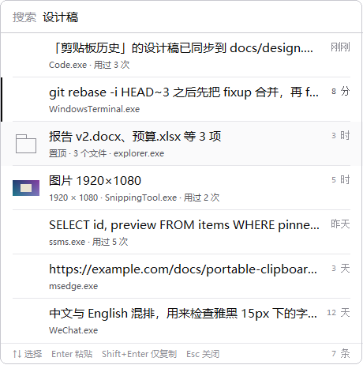
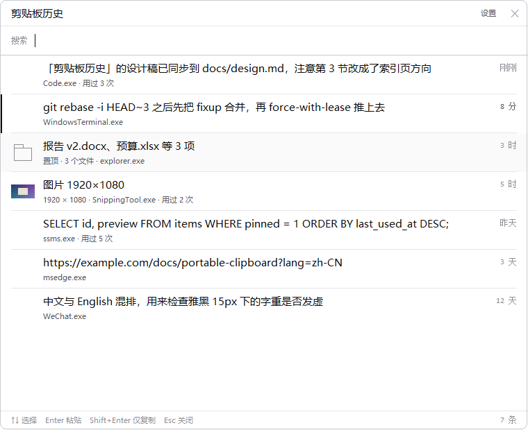

# 剪贴板历史 · ClipHist

Windows 便携版剪贴板历史工具：记录**文本 / 文件 / 图片**，热键呼出，回车即粘回原窗口。
整个程序是一个 exe，所有数据只存在同目录的一个 `data.db` 里。

技术栈刻意选 **Rust + 原生 Win32**（`windows-sys` 直调 user32/gdi32/shell32），
不引入 WebView、不引入 GUI 框架、不引入 comctl32 —— 因为需求里写死了"运行内存占用越低越好"，
而这几样东西每一个都要几十 MB 的代价。

## 界面



方向是**索引页**：安静的左边距、一种强排版语气、等宽右对齐的时间列，
每行不再重复"文本/文件/图片"的灰色方块（十行里八个一样，只是噪声）。
选中用反相表达；图片行的边距里是缩略图，文件行是一个文件夹轮廓，文本行留白。
设计取舍的完整说明见 [docs/design.md](docs/design.md)，设置窗口见
[settings.png](docs/images/settings.png)。

打开方式有两条路径，对应两种心情：

- **热键**（默认 `Alt+V`）→ 浮动列表跟着光标弹出，单击即粘贴。要的是快：眼睛不用离开光标。
- **托盘单击** → **主窗口在屏幕绝对居中**打开，760×620，可以慢慢翻；单击选中、双击/回车才粘贴。
  右上角是"设置"和"✕"，标题栏可拖动。

启动时有一小段开场动画（一张纸卡片落定 + 一条墨线扫过，820ms，不抢焦点、不阻塞启动、
开机自启时自动跳过），设置里可以关。



启动后是纯 GUI 子系统进程：**不会出现任何控制台窗口**（`--selftest` 等命令行模式除外）。

## 功能

- **文本 / 文件 / 图片**三类剪贴板内容都能记录：文本带预览，文件可整批粘回，图片带缩略图
- **去重**：同一内容重复复制不产生第二条，只累加使用次数
- **搜索**：逐字筛选；多个词用空格分开且**同时命中**，结果按相关度排序，命中处加下划线；先搜预览、没命中再搜正文
- **看图**：图片条目按 Ctrl+Enter 交给系统看图程序打开（可缩放/另存）
- **主窗口可缩放**：拖边缘即可（最小 520×380）
- **粘贴队列**：按 `空格` 把多条加入队列（①②③），再用 `Ctrl+Alt+V` 逐条粘贴 ——
  填表单、搬多段材料时不用反复翻历史。队列只在内存里，不写库
- **两种打开方式**：热键 `Alt+V` 弹出跟随光标的浮动列表（单击即粘贴）；
  托盘单击打开屏幕正中的主窗口（单击选中、双击/回车粘贴）
- **置顶收藏**、来源进程与使用次数记录、`Ctrl+D` 删除、右键菜单（打开/打开所在文件夹/复制路径）
- **保留策略**：条数 / 天数 / 图片总量三重上限，置顶豁免
- **便携**：所有数据都在程序同目录的单个 `data.db` 里
## 实测数据（本机 release 构建，`scripts\measure-memory.ps1`）

| 场景 | 私有提交内存 | 工作集 | 线程 | 句柄 |
|---|---|---|---|---|
| 空闲（空库） | **2.0 MB** | 11.4 MB | 5 | 136 |
| 空闲（500 条历史） | **2.3 MB** | 11.6 MB | 5 | 136 |
| 50 次连续复制之后 | **2.6 MB** | 12.0 MB | 5 | 138 |

| 指标 | 实测 |
|---|---|
| 预填 500 条入库 | 966 ms（约 1.9 ms/条），`data.db` 224 KB |
| 查询最近 300 条 | 406 µs |
| 关键字搜索（含正文回退） | 327 µs |
| 产物大小 | 1701 KB |
| 外部依赖 | 仅系统 DLL：kernel32 / user32 / gdi32 / shell32 / msimg32 / advapi32 / dwmapi（静态 CRT，**不依赖 vcruntime140.dll**） |

> 测量环境说明：上面这组数字是无托盘状态下测的 —— 本机沙箱给子进程的是受限令牌，
> `Shell_NotifyIcon` 被 UIPI 拒绝（`ERROR_ACCESS_DENIED`），所以图标没加上，
> 句柄数比正常桌面少几个。程序对此已做降级（无托盘仍可运行），正常桌面上的内存
> 会在同一量级、仅多几个句柄。

"500 条历史只多占 0.3 MB"不是巧合，而是设计出来的：列表只加载每条的前 200 字预览，
正文与图片按需读取、用完即释放；缩略图缓存上限 24 张；`data.db` 页缓存限制 512KB 并关闭内存映射。

## 快速开始

```powershell
# 构建便携版（跑测试 → release → 校验依赖 → 自检 → 打包到 dist-portable）
pwsh -File scripts\build.ps1

# 直接跑
.\dist-portable\ClipHist.exe
```

启动后常驻托盘，按 **Alt+V** 呼出历史列表。

| 按键 | 作用 |
|---|---|
| ↑ / ↓ | 选择 |
| Enter | 粘贴到原窗口 |
| Shift+Enter | 只放回剪贴板，不自动粘贴 |
| Ctrl+Enter | 打开选中图片（交给系统看图程序） |
| Ctrl+Shift+Enter | 把粘贴队列合并成一段多行文本复制走 |
| Ctrl+1 ~ 9 | 直接粘贴第 N 条 |
| Ctrl+P | 置顶 / 取消置顶（置顶＝常用，不会被自动清理） |
| Ctrl+D | 删除选中条目 |
| 右键 | 置顶 / 删除 / 打开 / 打开所在文件夹 / 复制路径 |
| Esc | 关闭 |

托盘菜单：显示历史 / 暂停记录 / 设置 / 开机自启 / 清空历史（保留置顶）/ 退出。

## 数据文件

`data.db` 就在 exe 同目录（单文件 SQLite，`journal_mode=DELETE`，空闲时不残留 `-wal`/`-journal`）。
整个目录拷到 U 盘或另一台电脑，历史与设置一起跟过去。

程序目录不可写时（例如放进 `C:\Program Files`）自动改存 `%LOCALAPPDATA%\ClipHist\data.db`，
并在设置窗口里显示**实际生效**的路径，同时用托盘气泡如实告知。

## 默认行为

- 去重：同一内容再次复制不会产生第二条，只累加使用次数并刷新时间。
- 保留策略：非置顶最多 500 条、30 天，图片总量 200 MB；置顶条目豁免。
- 大小上限：单条文本/路径 2 MB、图片 1200 万像素；超出**不记录并弹气泡**，绝不悄悄截断。
- 图片入库前长边超过 2560 会降采样，既是省库也是省回写时的瞬时内存。
- 不记录密码管理器标记了 `Clipboard Viewer Ignore` / `ExcludeClipboardContentFromMonitorProcessing` 的内容。
- 粘回文件时一律按"复制"写回（`DROPEFFECT_COPY`），绝不会把用户的文件移走。

## 目录结构

```
src/
  core/    纯逻辑：哈希、模型、SQLite 存储、保留策略、搜索、负载编解码   ← 无 Win32，可完整单测
  image/   纯编解码：DIB/DIBV5 解析与构造、缩放、PNG
  win/     Win32 直调：剪贴板、热键、托盘、注册表、单实例、DPI、进程查询
  ui/      自绘界面：GDI 原语、历史弹窗、设置窗口、主题、时间格式
  app.rs   状态机：控制器窗口过程，把采集/存储/UI/回写串起来
docs/      架构、界面设计、测试计划、手工验收清单
scripts/   build.ps1（打包）、measure-memory.ps1（内存实测）
packaging/ 便携版使用说明
```

## 文档

- [架构说明](docs/architecture.md) —— 分层、线程模型、数据流、数据库结构、内存预算与手段
- [界面设计](docs/design.md) —— 单色取向、反相选中、等宽数据字体、行布局与交互
- [测试计划](docs/test-plan.md) —— 测试分层、覆盖矩阵、以及**本环境无法验证的部分**
- [手工验收清单](docs/manual-checklist.md) —— 逐条步骤与预期结果

## 自己验证

```powershell
cargo test                                  # 124 个单元测试
.\dist-portable\ClipHist.exe --selftest     # 存储与图片编解码自检（21 项）
.\dist-portable\ClipHist.exe --selftest-clipboard   # 剪贴板读写自检（11 项，真调 Win32）
pwsh -File scripts\measure-memory.ps1       # 内存实测（三段采样 + 判定）

# 视觉回归：用正式绘制代码把界面渲染成 PNG（不显示窗口、不碰剪贴板/数据库）
.\dist-portable\ClipHist.exe --render-preview out.png
.\dist-portable\ClipHist.exe --render-preview empty.png --preview-empty
.\dist-portable\ClipHist.exe --render-settings settings.png
.\dist-portable\ClipHist.exe --render-preview main.png --preview-main
.\dist-portable\ClipHist.exe --render-splash splash.png --at 380

# 排障：把"通知 → 取数 → 过滤 → 落库"五段链路写进日志
.\dist-portable\ClipHist.exe --log clip.log
```

## 已知限制

- 仅支持 Windows 10 1809+ / Windows 11。
- 目标窗口以管理员权限运行时，Windows 的 UIPI 会丢弃模拟按键：此时内容仍会放进剪贴板，
  并弹气泡提示手动按 Ctrl+V（让本程序也以管理员身份运行可解决）。
- 默认热键 `Alt+V`（避开被系统占用的 `Win+V` 与编辑器里的 `Ctrl+Shift+V`），可在设置里改。
- **托盘图标创建失败时程序不会退出**：热键弹窗照常可用，列表页脚会显示"托盘不可用"。
  （受限令牌、无桌面外壳或被安全软件拦截时 `Shell_NotifyIcon` 会返回 `ERROR_ACCESS_DENIED`。）
- `data.db` 是**明文**存储的，剪贴板里可能有密码、验证码，请勿分享该文件。

## 许可

MIT

## 许可证

[MIT](LICENSE) © 2026 hunterlihao
