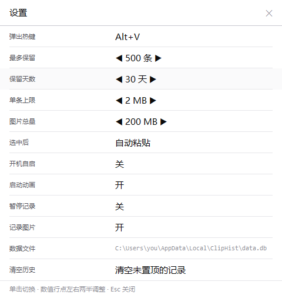

# 界面设计说明


## 0. 约束（来自需求）

- 主题：浅色，近单色；界面语言：中文。
- 运行环境：原生 Win32 + GDI，**不引入 comctl32**（因此没有主题化的按钮/列表/滚动条），
  不用任何位图素材，全部用 GDI 原语现场绘制。
- 「运行内存越低越好」是硬约束。这条直接决定了下面几乎所有选择。
- 视觉方向由 `frontend-design` 的方法给出：先定向，再定 token，再看真实渲染截图批判。

## 1. 方向：索引页（而不是控制面板）

剪贴板本质上是一叠纸片：你抄过什么、什么时候抄的、从哪抄的。所以界面按**索引页**来排：

- 安静的外边距。文字从一条固定的左边线开始，左边留出一段**可以空着的**边距。
- 一种强排版语气。预览是 15px Medium，其余都退到 11px。
- 时间像书页边缘的页码：**等宽、右对齐**，竖着对齐成一条干净的线。
- 结构用发丝线表达，不用卡片、不用分组框、不用阴影（浮层除外）。

## 2. 承担的那一个风险：大多数行没有图标

文本行的左侧边距是**空的**；只有图片行放缩略图、文件行放一个小文件夹轮廓。

理由：一行一个灰色"文本/文件/图片"方块是纯噪声 —— 十行里八个一模一样，眼睛必须先滤掉它们
才能读到内容。真正决定"这是不是我要那段话"的是预览文字，不是类型标签。去掉它们之后，
一屏的信息密度明显上升，版面也从"控件堆"变成了"目录"。

代价与补救：
- 每行牺牲一点横向空间（统一让出 46px 边距），换来一致的左对齐与偶尔出现的标记。
- 类型信息在**需要时**才出现：文件在元信息里写"N 个文件"，图片给出尺寸，各有一个形状标记。

配套的第二个决定：时间列走等宽 + 右对齐（`刚刚 / 8 分 / 3 时 / 昨天 / 3 天`），
用短格式（`relative_short`）而不是"3 分钟前"，才能对齐成一条竖线。

## 3. 令牌

### 颜色（零色相，五级灰 + 一个警示色）

| 令牌 | 值 | 用途 |
|---|---|---|
| `PAPER` | `#FFFFFF` | 纸面、画布、输入框底色 |
| `INK` | `#0B0B0C` | 主文字 / 选中墨条 / 结构线最深一级 |
| `INK2` | `#55555C` | 次级文字（来源进程、元信息、设置项名） |
| `INK3` | `#8E8E96` | 三级文字（时间、字段名、页脚、空态说明） |
| `RULE` / `RULE_STRONG` | `#E6E6EA` / `#C9C9D0` | 发丝分隔线 / 字段下划线、文件夹轮廓 |
| `HOVER` | `#F4F4F6` | 悬停底（比纸面深 4%） |
| `SEL_EDGE` | `#0B0B0C` | 选中行的左边缘墨条（3px）|
| `WARN` | `#B03E2C` | "未记录"、热键冲突、清空确认 |

没有强调色。**"当前是哪一行"既不靠反相黑底、也不靠浅灰底**：整行保持纸白，
只在最左侧画一道 3px 墨条（像编辑器里的当前行标记），时间列再微微加深一级作为第二重线索。
两道信号都很轻，但结构明确 —— 长列表里最容易犯的错是把"焦点"画成一个沉重的色块。
### 字体（两个角色）

| 角色 | 字族 | 用途 |
|---|---|---|
| 界面 | `Microsoft YaHei UI`（缺省回落 `Segoe UI`） | 预览 15px Medium、元信息 11px、设置值 15px |
| 数据 / 机器值 | `Consolas` | 时间列、条目计数、尺寸、文件路径、字段名 |

中文界面在 Windows 上可选的"展示字体"其实只有雅黑一套能看，所以字体主张放在**等宽**上：
凡是机器给出的值一律走等宽，时间、计数、路径才能竖着对齐、逐字符扫读。

预览用 Medium(500) 而不是 Normal(400)：中文在 15px 下 400 显得发虚，500 压得住版面，
又不像 Bold 那样把一整列文字糊成黑块。

### 几何（逻辑像素 @96dpi，随 DPI 缩放）

| 度量 | 值 | 说明 |
|---|---|---|
| 弹窗宽度 | 460 | 固定宽度，只在高度上贴合内容 |
| 最大 / 最小高度 | 600 / 160 | 1 条记录时不摆一大片空白 |
| 顶部搜索行 | 42 | 一条字段名 + 一行输入 + 一条实线 |
| 行高 | 56 | 两行文字，上下留 9px 呼吸 |
| 标记方框 | 34 | 缩略图 / 文件夹轮廓 |
| 页脚 | 28 | 左侧按键提示、右侧计数 |
| 外边距 / 间隙 | 16 / 12 | 文字左线 = 16 + 34 + 12 = 62 |
| 滚动条 | 3 | 自绘指示条，不响应拖动（滚轮与键盘才是主交互） |

## 4. 一行的解剖

```
  ▲pin
  │
┌─┃──────────────────────────────────────────────────────────┐
│ ┃  [缩略图]  预览文字（15px Medium，单行，溢出省略）   3 分 │ ← 等宽时间，右对齐
│ ┃            chrome.exe · 3 个文件 · 用过 2 次              │ ← 元信息（11px 次级灰）
└──────────────────────────────────────────────────────────────┘
   空着的边距是刻意的：只有图片/文件才在这里放标记
```

- 置顶：不再画几何标记（会和选中的左边缘墨条挤在同一个外边距里互相干扰），
  改为写进元信息行首：`置顶 · 3 个文件 · explorer.exe`。文字比图形更精确。
- 分隔：发丝线从外边距到外边距，选中行不需要（它自己就是一块墨）。
- 空态的居中必须用**当前窗口高度**而不是"最大高度"——这个 bug 正是靠离屏预览图发现的。

## 5. 主窗口与启动动画


同一个窗口类、同一份绘制代码，只是模式不同（`Mode::Popup` / `Mode::Main`）：

| | 浮动列表（热键） | 主窗口（托盘单击） |
|---|---|---|
| 打开位置 | 跟随光标，下方放不下就翻到上方 | **屏幕绝对居中**（主显示器工作区） |
| 尺寸 | 460 宽，高度随条数自适应 | 760×620 固定 |
| 顶部 | 只有搜索行 | 标题栏 + 搜索行 |
| 单击行 | 立即粘贴（要快） | 只选中（在浏览）|
| 粘贴 | 单击 / 回车 | 双击 / 回车 |
| 关闭 | 失焦 / Esc | ✕ / Esc |

"要快"和"要稳"是两种不同的使用场景，所以没有用同一个窗口去兼顾：
热键要的是"眼睛不用离开光标"，托盘要的是"我愿意看看历史里都有什么"。
标题栏不是系统标题栏（那套框架和这份排版语言不搭），拖动由 `WM_NCHITTEST`
返回 `HTCAPTION` 实现，右侧是"设置"和"✕"。

### 启动动画


一张纸卡片从下方 10px 落到位，底部一条墨线扫过（表示"正在挂上剪贴板监听"），
然后整张淡出，全程 820ms。三条硬约束写在 `ui/splash.rs` 顶部：
**不抢焦点**（`WS_EX_NOACTIVATE`）、**不阻塞启动**（`SetTimer` 推进）、
**不占内存**（整体透明度 + 窗口区域裁圆角，不做逐像素 alpha，窗口结束后自毁）。
开机自启时一律不显示 —— 那时候用户没在等，弹一张卡片只会打扰；设置里可关。

## 6. 交互

- **单击即粘贴**（与 Win+V 一致），不要求双击。
- 呼出后焦点直接在输入行，方向键上下选择，回车粘贴。
  `↑/↓/PgUp/PgDn/Home/End/Enter/Esc/Ctrl+P/Ctrl+D` 由子类化过程拦截并转给列表，
  **其余按键（退格、左右键、字母）原样交给 EDIT**，中文输入法因此完全正常。
- 逐字筛选；预览无命中才回退到正文搜索（限最近 2000 条、单条正文 < 256KB）。
- 点击别处 / 切走即关闭。
- 页脚常驻按键提示；暂停记录时右侧计数替换为"已暂停"。

### 顶部为什么没有"输入框"

顶部只有三样东西：等宽的字段名"搜索"、一行文字、一条贯穿的实线。
没有边框、没有浅灰底、没有圆角 —— 那会让顶部看起来像"控制面板"。
占位提示（cue banner）在这里是**不可行**的：呼出时焦点立刻进入输入框，
任何"聚焦即清空占位"的实现都等于占位永远不显示。所以提示语义交给字段名承担，
空输入框的真实形态是"一根光标"。


## 7. 设置窗口



同一套语法：横栏标题 + 一条实线，一列"条目名 / 值"。没有按钮、没有下拉框、没有复选框，
只有一个交互模型：

- **布尔行**：点一下切换（开/关、自动粘贴/仅放回剪贴板）。
- **数值行**：点左右两半减小/增大（值里用 `◀ ▶` 明示）。
- **热键行**：点一下进入捕获态（值变成"请按下新组合键…"），Esc 取消；
  不带修饰键的组合会被拒绝，因为那会抢走用户的普通打字。
- **清空行**：两段式确认，避免误触。
- **数据文件行**：显示实际生效路径（等宽小字，长路径才塞得下），点击打开所在目录。

层级也是索引式的：条目名 11px 次级灰（安静），值 15px 主墨（真正要读的）。

## 8. 系统级细节

- **窗口圆角**：Win11 下用 DWM 的 `DWMWA_WINDOW_CORNER_PREFERENCE` 拿系统圆角，
  同时外框改画圆角描边 —— 否则直角的 1px 边框会从圆角窗口的四角探出来。Win10 自动退回直角。
- **浮层阴影**：窗口类加 `CS_DROPSHADOW`，让弹窗像真的浮层而不是贴纸。
- **托盘图标**：运行时用 GDI 画进 32bpp DIB 再 `CreateIconIndirect`（浅色卡片 + 夹子 + 两行文字），
  尺寸取 `SM_CXSMICON`。注意 **GDI 画像素不写 alpha**：先填哨兵色，画完按"是否等于哨兵色"
  判定透明，否则会得到一张全透明图标。
- **DPI**：进程级 Per-Monitor V2，`WM_DPICHANGED` 后按新 DPI 重建字体与度量。

## 9. 怎么验证视觉（开发流程的一部分）

原生 GUI 没法靠"看一眼浏览器"迭代，所以加了一个开发者预览开关：

```powershell
# 用正式绘制代码把弹窗渲染成 PNG（不显示窗口、不碰剪贴板、不碰数据库）
.\ClipHist.exe --render-preview out.png
.\ClipHist.exe --render-preview empty.png --preview-empty
.\ClipHist.exe --render-preview filtered.png --preview-query "git"
.\ClipHist.exe --render-settings settings.png
.\ClipHist.exe --render-preview main.png --preview-main
.\ClipHist.exe --render-splash splash.png --at 380
```

渲染走的是**同一份** `render()`，所以截图就是用户会看到的画面。
本目录下的三张图全部由这些命令生成，改完代码可以随时重渲染对比。
离屏位图不含子窗口（EDIT），因此预览模式下由父窗口代画输入行内容（空串就画一根光标）。
